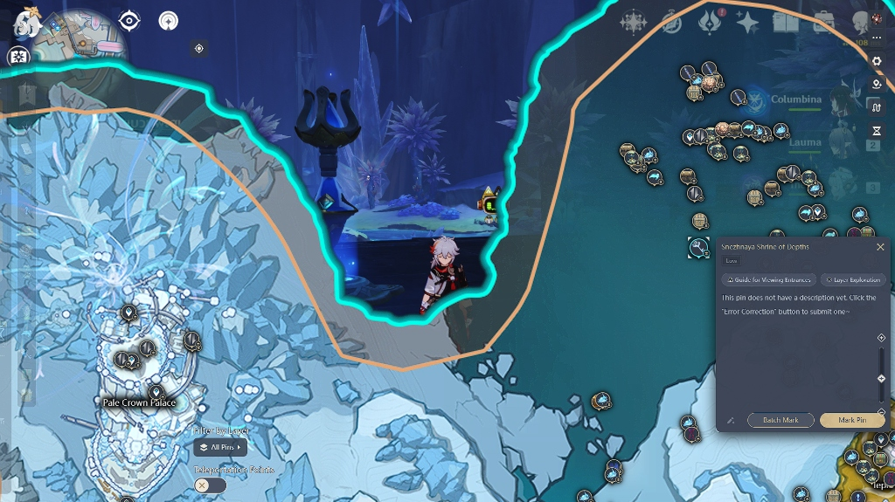
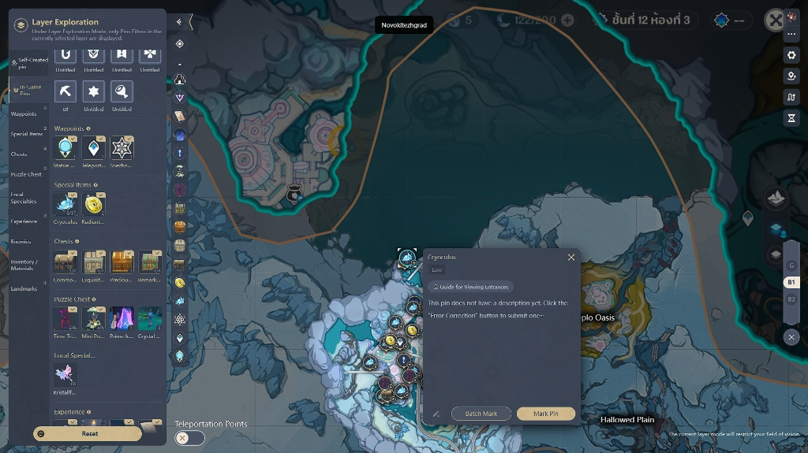
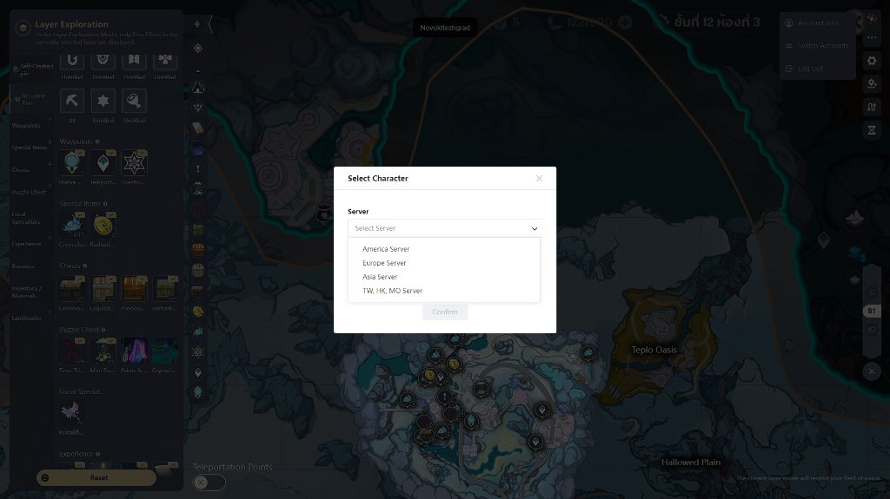
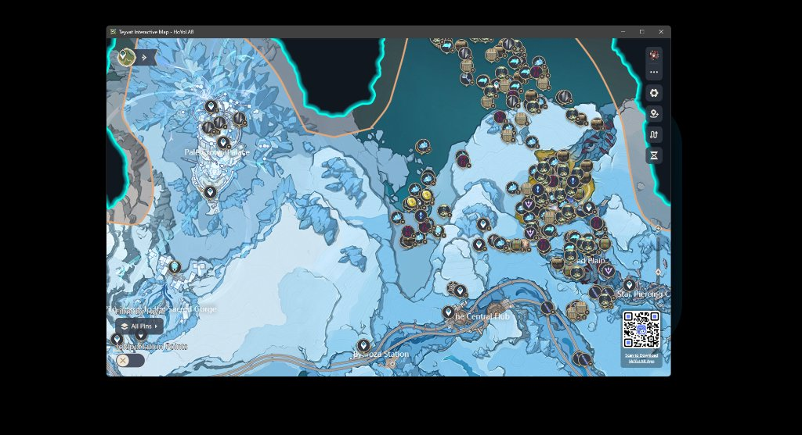

# Genshin HoYoLAB In-Game Map Overlay

A transparent, lightweight in-game overlay for the official HoYoLAB interactive map. Built so you can track chests, Oculi, and quest routes directly on top of Genshin Impact without needing a second monitor or constantly Alt-Tabbing.

---

## 📸 Screenshots

### 🎮 In-Game Map Overlay
The map floats directly over your game with the dark ocean background filtered out, so your game stays clearly visible underneath.

---

### 🗺️ Underground & Cave Navigation
Full support for multi-layer maps (Surface, B1, B2) and entrance guides. Never get lost in subterranean caves again.

---

### ☁️ Official Account & Real-Time Cloud Sync
Log in directly with your official HoYoverse account. Select your server and character, and all your marked pins sync automatically in real time.

---

### ⚙️ Setup Mode (`F8`)
Press F8 anytime to switch into windowed mode for easy first-time login, adjusting filters, or standard map browsing.

---

## ✨ Features

- **No Alt-Tab Needed**: The official HoYoLAB map stays right on your screen while playing.
- **Dark Ocean Background Removed**: Automatically cuts out the dark water textures and empty voids, leaving only landmasses, roads, and pins floating over the game.
- **Direct HoYoLAB Cloud Sync**: Uses the real HoYoLAB map — everything you mark or sync saves straight to your official HoYoverse account.
- **One-Key Mouse Toggle (`F9`)**: Hit F9 to click and mark pins, hit F9 again to immediately return mouse control back to Genshin.
- **Adjustable Opacity (`F10`)**: Cycle through transparency levels, including a "Pins Only" mode where the map terrain disappears completely and only pins hover over your game.
- **Lightweight & Smooth**: Runs quietly in the background with near-zero idle CPU usage and no impact on in-game FPS.
- **Works with Admin Privileges**: Hotkeys respond properly even when Genshin Impact is running with Administrator rights.

---

## ⌨️ Hotkeys

| Key | What it does |
| :--- | :--- |
| **`F9`** | **Toggle Mouse Mode:** Switch between interacting with the map $\leftrightarrow$ returning mouse to the game |
| **`F7`** | **Show / Hide:** Instantly show or hide the overlay |
| **`F10`** | **Cycle Opacity:** 0% (Pins only) $\rightarrow$ 25% $\rightarrow$ 50% $\rightarrow$ 75% $\rightarrow$ 100% |
| **`F8`** | **Setup Mode:** Switch between transparent overlay and standard windowed mode |
| **`F6`** | **Toggle Sidebar:** Collapse or expand the left filter panel |

---

## 🚀 Quick Start

1. Download the latest `.zip` from [Releases](https://github.com/DesStoeng/genshin-hoyolab-overlay/releases).
2. Extract the folder anywhere on your PC and run `Genshin HoYoLAB Overlay.exe`.
3. **First-time Login**:
   - Press **`F8`** to open Setup Mode.
   - Log into your HoYoverse account and pick your server/character so cloud sync activates.
   - Press **`F8`** to return to Overlay Mode.
4. **Playing the Game**:
   - Set Genshin Impact to **Borderless** or **Windowed** mode.
   - Press **`F9`** whenever you want to mark pins or move the map.
   - Press **`F9`** again to jump right back into gameplay.
   - Press **`F7`** anytime to hide the overlay.

---

## ❓ FAQ

**Q: Is this safe? Will I get banned?**  
**A:** Yes, it is safe. This overlay does **not** inject code, hook game processes, modify game files, or read game memory. It is simply a transparent web window running on Windows that floats over your screen, similar to Discord or OBS overlays.

**Q: Do my marked pins save to my account?**  
**A:** Yes! The overlay runs the official HoYoLAB map inside. As long as you log into your HoYoverse account in Setup Mode (`F8`), all marked pins sync with your cloud account across all devices.

---

## 💬 Community & Feedback

Have questions, suggestions, or found a bug? Come chat with us:

- 💬 **Discord:** [https://discord.gg/SKjZYumAUu](https://discord.gg/SKjZYumAUu)
- 🐛 **Issue Tracker:** [GitHub Issues](https://github.com/DesStoeng/genshin-hoyolab-overlay/issues)

---

## 💖 Support

If this tool made exploring Teyvat and finding chests a little easier for you, feel free to support the project! Every coffee helps keep updates coming:

